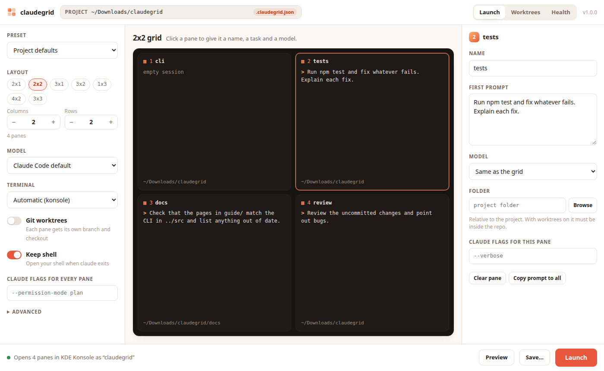

<p align="center" class="logo-section">

<br/>


<p align="center">
Run a grid of Claude Code agents in one command, on Linux and macOS.<br>
Konsole, iTerm2, Terminal.app, tmux, kitty and WezTerm. A prompt, model and git worktree per pane.<br>
<br/>
<a href="https://github.com/halitsever/claudegrid/actions/workflows/ci.yml"></a>
<a href="https://www.npmjs.com/package/@halitsever/claudegrid"></a>

</p>
<p align="center">
<a align="center" href="https://halitsever.github.io/claudegrid/">Documentation</a>
  </p>
</p>

<p align="center">

</p>

<p align="center">

</p>

- **Any grid** - `2x2` by default, or `3x2`, `1x3`, or a pane count. Panes come out evenly sized
- **A task per pane** - `claudegrid -p "fix lint" -p "write tests"` starts each pane on its own prompt
- **Git worktrees** - `--worktrees` puts every agent on its own branch and checkout, so they never edit the same files
- **Presets** - save teams of agents in `.claudegrid.json` and start them with `claudegrid review`
- **Linux and macOS** - see [supported terminals](#supported-terminals). Opens as a new tab in the terminal you are in
- **Desktop app** - `claudegrid ui` opens a window to set up panes, preview and launch, no terminal needed
- **Safe to try** - `--dry-run` prints every command, `doctor` checks your setup, config typos get a "did you mean"
- **No runtime dependencies** - plain Node.js, shell completion for bash, zsh and fish

<p align="center" >

</p>

```sh
npm install -g @halitsever/claudegrid
```

Debian and Ubuntu:

```sh
curl -fLO https://github.com/halitsever/claudegrid/releases/latest/download/claudegrid.deb
sudo apt install ./claudegrid.deb
```

or with the install script:

```sh
curl -fsSL https://raw.githubusercontent.com/halitsever/claudegrid/main/install.sh | bash
```

You need Node.js 20+, [Claude Code](https://claude.com/claude-code) and one of the supported terminals. Run `claudegrid doctor` to check.

### Usage

```sh
claudegrid                                   # 4 panes in the current directory
claudegrid -l 3x2 -m opus                    # 6 panes on Opus
claudegrid -p "add a /health endpoint" -p "fix the tests" -p "review the diff"
claudegrid -w -n 3                           # 3 agents on separate git worktrees
claudegrid -b tmux -d                        # tmux session in the background
claudegrid -- --continue                     # pass flags to every claude
claudegrid --dry-run                         # show what would run
claudegrid --no-trust                        # let Claude Code ask its "trust this folder" question
```

### Supported terminals

| Terminal | Platform | How the grid opens |
| --- | --- | --- |
| KDE Konsole | Linux | split panes in a new tab or window |
| iTerm2 | macOS | split panes in a new tab or window |
| Terminal.app | macOS | one window per pane, tiled over the screen |
| tmux 3.1+ | Linux, macOS, SSH | split panes in a new tmux window or session |
| kitty | Linux, macOS | a new kitty window with the grid layout |
| WezTerm | Linux, macOS | split panes in a new tab or window |

`auto` uses the terminal you run claudegrid in when it can split, and otherwise the first one installed in the order above, with Terminal.app last. Pick one with `-b`, for example `claudegrid -b terminal`. `claudegrid doctor` shows what works on your machine.

On macOS, the first launch asks whether your terminal may control iTerm2 or Terminal. Allow it, or later in **System Settings > Privacy & Security > Automation**.

### Desktop app

```sh
claudegrid ui                  # open the app window
claudegrid desktop install     # add claudegrid to your app menu
```

<p align="center">

</p>

Pick a project, click a pane to give it a name, prompt and model, preview the commands and launch. It can also save presets and clean up worktrees. It runs on `127.0.0.1` behind a random token, so only you can reach it. [More about the app](https://halitsever.github.io/claudegrid/guide/app).

### Config and presets

`claudegrid init` writes a `.claudegrid.json` you can edit:

```json
{
  "$schema": "https://halitsever.github.io/claudegrid/schema.json",
  "model": "sonnet",
  "panes": [
    { "name": "api", "dir": "server", "prompt": "Add rate limiting to the public endpoints" },
    { "name": "web", "dir": "web" },
    { "name": "tests", "prompt": "Run the test suite and fix whatever fails" },
    { "name": "review", "model": "opus", "prompt": "Review the uncommitted changes" }
  ],
  "presets": {
    "swarm": { "description": "Six agents on their own branches", "panes": 6, "worktrees": true }
  }
}
```

```sh
claudegrid          # the four panes above
claudegrid swarm    # the preset
```

Read more: [desktop app](https://halitsever.github.io/claudegrid/guide/app), [configuration](https://halitsever.github.io/claudegrid/guide/configuration), [presets](https://halitsever.github.io/claudegrid/guide/presets), [worktrees](https://halitsever.github.io/claudegrid/guide/worktrees), [terminals](https://halitsever.github.io/claudegrid/guide/terminals), [CLI reference](https://halitsever.github.io/claudegrid/guide/cli).

<p align="center">
<a href="https://github.com/halitsever/claudegrid/issues"></a>
</p>

<p align="center">
Found a bug or have an idea? Open an <a href="https://github.com/halitsever/claudegrid/issues">issue</a>.<br/>
Read the <a href=".github/CONTRIBUTING.md">contributing guide</a> before sending a pull request.
</p>

### Related projects

- [claude-code-vps](https://github.com/halitsever/claude-code-vps): one command sets up an Ubuntu server for Claude Code with Plasma over RDP, hardened SSH, Docker and config sync. It preinstalls claudegrid.
- [HaltOS](https://github.com/halitsever/haltos): a monochrome KDE Plasma theme and OS identity layer for Claude Code servers, installed on top of claude-code-vps.
- [explain-to-customer](https://github.com/halitsever/explain-to-customer): an agent skill for Claude Code that turns a code change into a short video, slides and diagrams for a client.

<p align="center">

</p>

<p align="center">

</p>

<p align="center">
Released under the <a href="LICENSE">MIT License</a>.
</p>
